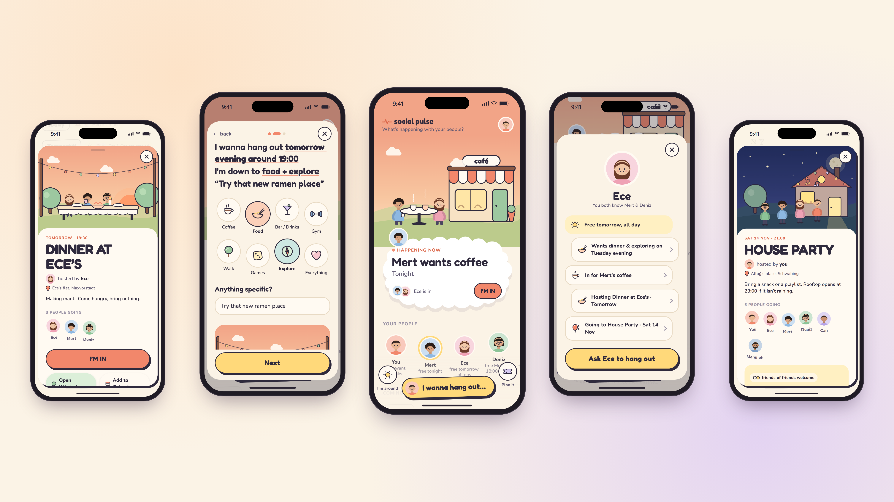

# Social Pulse

A mobile app for spontaneous plans with friends. Say "I wanna hang out", see who's in, and turn it into a real plan.



## The idea

Most plans with friends die in a group chat. Social Pulse lets you put an intention out there ("coffee this afternoon?", "anyone up for a walk tonight?"). Friends tap **I'M IN**, and once people join you confirm it into a plan with a time.

- **Intentions and events.** Post a loose intention or a fixed event. An intention becomes an event once people join.
- **Visibility.** Share with all friends, one of your groups, or a few people by name. Events can be opened to friends of friends, one step out.
- **Availability.** Mark when you're free, so friends know who's around before anyone asks.
- **No built-in chat.** When a plan is set, the conversation moves to WhatsApp.
- **Illustrated home screen.** The scene changes with the activity and the time of day, with your friends' avatars in it.

## Status

A working prototype for iPhone and Android, running on in-memory test data. All data access goes through the [`SocialDataProvider`](src/data/SocialDataProvider.ts) interface, so a real backend can replace the mock provider without touching the screens.

## Tech stack

React Native with Expo (SDK 57) and Expo Router, TypeScript, Zustand for state, and animated SVG illustrations via `react-native-svg` and Reanimated.

## Project structure

```text
src/
  app/          Screens (Expo Router file-based routes)
  components/   UI, grouped by feature (pulse, create, focus, people, scene, ...)
  data/         SocialDataProvider interface and the mock implementation
  domain/       Types and pure logic: activities, time, visibility rules
  services/     Hand-offs to other apps (WhatsApp, calendar)
  state/        Zustand store and hooks
  theme/        Colours, typography, layout and motion tokens
```

## Running it

Requires Node.js LTS and the Expo Go app on your phone.

```bash
npm install
npx expo start            # scan the QR code with Expo Go
npx expo start --tunnel   # if your phone isn't on the same network
```

Checks:

```bash
npm run typecheck
npm run lint
```

More screens are in [`screenshots/framed`](screenshots/framed).

## License

[MIT](LICENSE)
